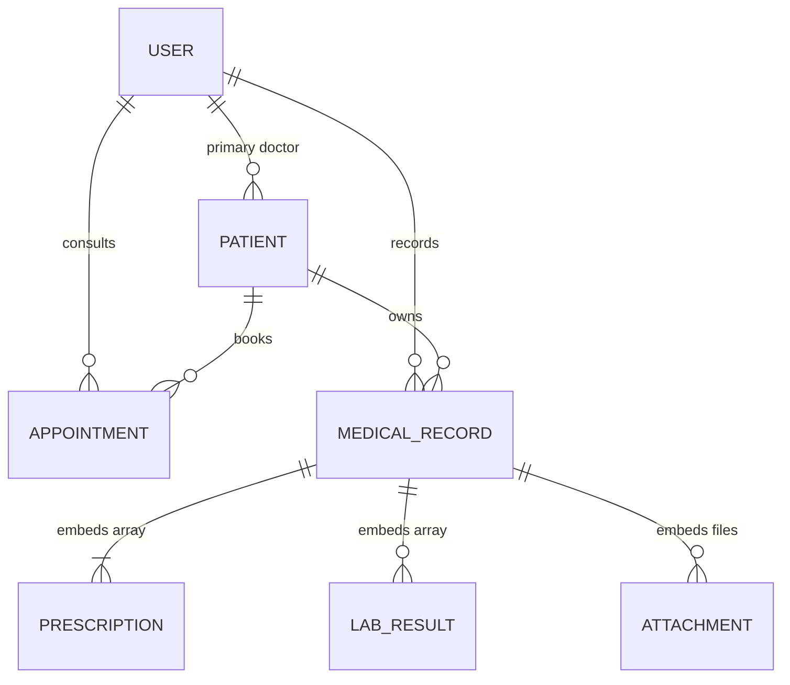

# MedCare RMS — Comprehensive Project Documentation & Defense Guide

---

## 1. Executive Summary & Project Overview

**MedCare RMS** is a modern, enterprise-grade **Patient Record Management System** engineered exclusively on the **MERN** technology stack (**M**ongoDB, **E**xpress.js, **R**eact.js, **N**ode.js). 

It is designed to replace paper records, disjointed spreadsheets, and insecure communication in hospital/clinic environments with:
1. **Granular Role-Based Access Control (RBAC)** across three distinct administrative tiers: `Admin`, `Doctor`, and `Receptionist`.
2. **Visual Appointment Scheduling & Conflict Resolution**: Interactive calendar (`react-big-calendar`) calculating real-time doctor availability in 30-minute time slots to strictly prevent double-booking.
3. **Comprehensive Patient Registry**: Structured demographic, vitals, blood type, and emergency contacts linked to an auto-generated unique ID (`P-XXXXXX`).
4. **Clinical Consultations & Structured Electronic Prescriptions**: Chief complaints, clinical diagnoses, dynamic medications (drug, dosage, frequency, duration), and laboratory investigation tracking.
5. **Medical Document Storage**: Secure physical disk storage for diagnostic reports and prescription scans using Multer with MIME-type whitelist filtering.

---

## 2. Deep Dive: The 4 MERN Stack Components

Explain to your teacher how each layer of the MERN architecture handles data flow:

```
+---------------------------------------------------------------------------------------+
|  1. REACT.JS (Frontend Client - Port 5173)                                            |
|     - Single Page Application (SPA) with React Router DOM v6                          |
|     - State Management: AuthContext (JWT) + TanStack React Query (Server Cache)       |
|     - UI: Tailwind CSS + Lucide Icons + React Big Calendar                            |
+------------------------------------------+--------------------------------------------+
                                           | HTTP Requests (Axios /api/*)
                                           v
+---------------------------------------------------------------------------------------+
|  2. EXPRESS.JS (Routing & Middleware Layer)                                           |
|     - REST API Controllers, Input Validation, CORS Policies                           |
|     - JWT Verification (auth.js) & Role Validation (roleCheck.js)                     |
|     - Multer File Upload Pipeline (upload.js)                                         |
+------------------------------------------+--------------------------------------------+
                                           | Process Execution & Event Loop
                                           v
+---------------------------------------------------------------------------------------+
|  3. NODE.JS (Runtime Environment - Port 5000)                                         |
|     - Asynchronous, Non-blocking I/O Engine (V8 Engine)                               |
|     - Static File Server (Serving /uploads and bundled React frontend)                |
|     - Dual-mode Database Initializer & Local Engine Handler                           |
+------------------------------------------+--------------------------------------------+
                                           | Object-Data Modeling (Mongoose ODM)
                                           v
+---------------------------------------------------------------------------------------+
|  4. MONGODB (Database Layer)                                                          |
|     - NoSQL Document Store (BSON format)                                              |
|     - Collections: users, patients, appointments, medicalrecords, auditlogs           |
|     - Hybrid Design: Referenced entities + Embedded prescription & lab arrays         |
+---------------------------------------------------------------------------------------+
```

### Component Breakdown to Explain to Your Teacher

#### M — MongoDB (Data Persistence)
- **Role**: High-performance, schema-flexible NoSQL document database.
- **Why it fits healthcare**: Medical records often vary by specialty. A cardiologist records blood pressure and ECG metrics; a pediatrician records growth curves. MongoDB's JSON-like BSON documents allow structured arrays (prescriptions, lab tests) to live inside the medical record without requiring complex 5-table SQL joins.
- **Mongoose ODM**: Provides schema validation, type enforcement, middleware pre-save hooks (e.g., auto-hashing passwords via bcrypt and generating IDs), and relationship population (`.populate()`).

#### E — Express.js (Backend Framework)
- **Role**: Minimalist web application framework running on Node.js.
- **Why it fits**: Simplifies route creation, REST API endpoints (`GET`, `POST`, `PUT`, `DELETE`), middleware chaining (`auth` $\to$ `roleCheck` $\to$ `controller`), and centralized error handling (`errorHandler.js`).

#### R — React.js (User Interface)
- **Role**: Declarative, component-based frontend library.
- **Why it fits**: Provides a responsive Single Page Application (SPA). Pages change instantly without reloading the browser window.
- **Key libraries**:
  - `react-router-dom`: Protected client-side routing.
  - `@tanstack/react-query`: Asynchronous data fetching, background caching, and automatic invalidation.
  - `react-hook-form`: Performant form handling with dynamic sub-arrays (`useFieldArray`).
  - `react-big-calendar` + `moment`: Interactive multi-view scheduling calendar.

#### N — Node.js (Runtime Environment)
- **Role**: Server-side JavaScript runtime built on Chrome's V8 engine.
- **Why it fits**: Its single-threaded, event-driven, non-blocking I/O model handles concurrent requests from multiple clinic receptionists, doctors, and nurses without thread-locking overhead.

---

## 3. Database Architecture (MongoDB in Depth)

### The Dual-Mode Connection Strategy (Local, Atlas & Hotspot)

Your teacher will likely ask: **"How did you connect MongoDB?"** or **"How does it work over a mobile hotspot?"**

Here is your exact explanation:

> *"Our backend uses a resilient, dual-mode database connection architecture configured in `server/config/db.js`:*
> 1. *It first attempts to establish a connection to an external or local MongoDB instance defined in `.env` (`mongodb://localhost:27017/patient_rms` or a cloud-hosted MongoDB Atlas URI).*
> 2. *If no MongoDB daemon is running locally, instead of crashing, our backend automatically boots a zero-setup embedded in-memory MongoDB engine (`mongodb-memory-server`) on an available port, seeds sample staff accounts, patients, and clinical records, and allows instant testing without manual database installation.*
> 3. *When demonstrating over a phone hotspot or local Wi-Fi, the backend binds to all interfaces (`0.0.0.0` / port 5000), and the Vite frontend proxies requests through `VITE_API_URL` or relative paths, allowing any device on the Wi-Fi/Hotspot network to interact with the database without IP conflicts."*

### Schema Design & Collection Modeling

Our system employs a **Hybrid Modeling Approach** (combining Normalized References with Denormalized Embedding):



1. **`users` Collection ([server/models/User.js](file:///d:/PRJ/server/models/User.js))**:
   - Stores clinic staff (Admin, Doctor, Receptionist).
   - Features a Mongoose pre-save hook that hashes passwords with `bcryptjs` (cost salt: 12).
   - Strips the password hash from JSON responses via schema `toJSON` transform.

2. **`patients` Collection ([server/models/Patient.js](file:///d:/PRJ/server/models/Patient.js))**:
   - Contains demographic data, emergency contact details, and a reference (`ref: 'User'`) to the primary assigned physician.
   - Automatically generates a 6-character unique identifier with a pre-save hook (e.g., `P-X9K2L1`).

3. **`appointments` Collection ([server/models/Appointment.js](file:///d:/PRJ/server/models/Appointment.js))**:
   - Stores references to both the `patient` and the `doctor`.
   - Records calendar date, 30-minute time slot (`09:00`, `14:30`), status enum (`scheduled`, `confirmed`, `completed`, `cancelled`, `no-show`), and clinical reasons.

4. **`medicalrecords` Collection ([server/models/MedicalRecord.js](file:///d:/PRJ/server/models/MedicalRecord.js))**:
   - **Why Embedded Arrays?** Prescriptions, Lab Results, and File Attachments are directly embedded within the document. When a doctor loads a patient's visit, all prescribed medications, dosages, and diagnostic reports load in a **single atomic query** without costly multi-table joins.

5. **`auditlogs` Collection ([server/models/AuditLog.js](file:///d:/PRJ/server/models/AuditLog.js))**:
   - Maintains an immutable historical log of who created or updated patient records for healthcare compliance.

---

## 4. Code Navigation: What to Show vs. What to Skip

When screen-sharing or presenting code to your teacher, focus on high-value logic:

### Files You MUST Show (Core Architectural Highlights)

| Priority | File Path | What to Highlight to Your Teacher |
|:---:|---|---|
| **1** | [server/config/db.js](file:///d:/PRJ/server/config/db.js) | Dual-mode MongoDB connection with automatic fallback and self-seeding demo data. |
| **2** | [server/models/MedicalRecord.js](file:///d:/PRJ/server/models/MedicalRecord.js) | Hybrid schema design showing embedded sub-documents for prescriptions and lab tests. |
| **3** | [server/controllers/appointments.controller.js](file:///d:/PRJ/server/controllers/appointments.controller.js) | The algorithmic slot calculator (`getSlots`) and the query that prevents duplicate bookings. |
| **4** | [server/middleware/roleCheck.js](file:///d:/PRJ/server/middleware/roleCheck.js) & [auth.js](file:///d:/PRJ/server/middleware/auth.js) | JWT verification and clean Higher-Order Middleware enforcing role permissions. |
| **5** | [client/src/api/axios.js](file:///d:/PRJ/client/src/api/axios.js) | Axios response interceptor that transparently handles HTTP 401 and rotates refresh tokens. |
| **6** | [client/src/pages/records/RecordForm.jsx](file:///d:/PRJ/client/src/pages/records/RecordForm.jsx) | React Hook Form using `useFieldArray` to dynamically append/remove prescriptions in real time. |
| **7** | [client/src/pages/appointments/AppointmentCalendar.jsx](file:///d:/PRJ/client/src/pages/appointments/AppointmentCalendar.jsx) | Integration of `react-big-calendar` with doctor filtering and status color coding. |

### Files You Should NOT Show (Boilerplate / Low-Value)

- `client/node_modules/` or `server/node_modules/` — Third-party library internals.
- `package-lock.json` — Dependency lock tree.
- `client/postcss.config.js` or `tailwind.config.js` — Standard styling config.
- `client/dist/` — Compiled production build output.
- `server/uploads/` — File storage directory (explain its purpose instead of opening raw binary files).

---

## 5. End-to-End Request Flow (How Everything Connects)

Explain this lifecycle when asked: **"What happens when a doctor creates an appointment?"**

```
1. DOCTOR CLICKS 'CONFIRM APPOINTMENT' ON REACT UI
   └─> AppointmentForm.jsx collects { patientId, doctorId, date, timeSlot }
   └─> Triggers React Query mutation invoking appointments.api.js

2. AXIOS REQUEST INTERCEPTOR EXECUTES
   └─> Attaches 'Authorization: Bearer <accessToken>' from localStorage
   └─> Dispatches HTTP POST to http://localhost:5000/api/appointments

3. EXPRESS BACKEND RECEIVES REQUEST
   └─> server.js routes request to appointments.routes.js
   └─> Middleware 1: auth.js verifies JWT signature and extracts doctor's user ID
   └─> Middleware 2: roleCheck.js verifies user is 'doctor', 'admin', or 'receptionist'

4. CONTROLLER EXECUTION & BUSINESS LOGIC
   └─> appointments.controller.js executes createAppointment()
   └─> Queries MongoDB Appointment collection to check for time-slot conflicts on that date
   └─> If conflict exists: returns HTTP 409 Conflict with explanation
   └─> If slot is free: executes Mongoose Appointment.create() and logs an AuditLog entry

5. DATABASE WRITE & RESPONSE
   └─> MongoDB persists the BSON document and returns the created document
   └─> Controller responds with HTTP 201 Created and { success: true, appointment }

6. REACT UI REACTIVITY
   └─> React Query invalidates ['appointments'] cache key
   └─> React-Big-Calendar refetches and paints the new appointment in green/blue
   └─> React-Toastify triggers a notification: "Appointment scheduled successfully!"
```

---

## 6. Likely Teacher Questions & Exact Model Answers

### Q1: "Why did you use MongoDB instead of MySQL or PostgreSQL?"
> **Answer**:
> *"Medical records are inherently semi-structured and hierarchical. In SQL, a single consultation with multiple prescriptions, lab values, and file attachments requires 4 to 5 normalized tables with foreign key constraints, resulting in expensive JOIN operations for every read. In MongoDB, we use a hybrid model: independent entities like Users and Patients are referenced by ID, while visit-specific items like prescriptions and lab results are embedded directly inside the MedicalRecord document. This yields single-query retrieval, atomic writes, and high scalability."*

---

### Q2: "How does Authentication and Session Security work?"
> **Answer**:
> *"We implemented stateless JWT authentication with dual-token rotation:
> 1. Passwords are never stored in plaintext; they are hashed using `bcryptjs` with 12 salt rounds before persisting to MongoDB.
> 2. On login, the server issues a short-lived **Access Token** (15 minutes) and a longer-lived **Refresh Token** (7 days).
> 3. The React client intercepts outgoing HTTP requests to attach the Access Token in the `Authorization: Bearer` header.
> 4. If the access token expires (HTTP 401), our Axios response interceptor in `axios.js` silently calls `/api/auth/refresh` using the refresh token, updates localStorage with the new token, and replays the original request without disrupting the user."*

---

### Q3: "How does the system prevent two patients from booking the same doctor at the same time?"
> **Answer**:
> *"We handle this both proactively and reactively:
> - **Proactively**: When a user selects a doctor and date, our `GET /api/appointments/slots` endpoint calculates all 30-minute intervals between 09:00 and 17:00, compares them against existing bookings in MongoDB, and disables already-booked slots on the frontend.
> - **Reactively**: Before saving in `appointments.controller.js`, a MongoDB query checks for any active appointment (`status != 'cancelled'`) matching that doctor, date range, and time slot. If a race condition occurs, it returns an HTTP 409 Conflict error and aborts the write."*

---

### Q4: "How are file uploads (prescriptions and diagnostic reports) handled?"
> **Answer**:
> *"We use **Multer** configured as middleware in `server/middleware/upload.js`. When a document is uploaded, Multer validates the file size (maximum 10MB) and checks the MIME type against an allowed whitelist (PDF, PNG, JPEG, DOC, DOCX). The file is saved to the server's disk storage under `server/uploads/` with a unique timestamped filename to prevent name collisions, and its metadata (original name, path, file size, upload date) is appended to the `attachments` array of the patient's medical record in MongoDB."*

---

### Q5: "How did you connect over a Wi-Fi Hotspot or share with another device?"
> **Answer**:
> *"Our Vite configuration uses `--host`, binding both the frontend and Express backend to `0.0.0.0` (all network interfaces). When connected to a phone hotspot, the host computer is assigned a local IP (e.g., `192.168.0.105`). By configuring `client/vite.config.js` with dynamic reverse proxying for `/api` and `/uploads`, any phone or laptop connected to the same hotspot can navigate to `http://192.168.0.105:5173` and use the full application seamlessly without CORS errors."*

---

## 7. Demo Checklist for Presentation Day

1. **Start the Servers**:
   ```powershell
   npm run dev
   ```
2. **Open the Browser**: Navigate to [http://localhost:5173](http://localhost:5173).
3. **Demonstrate Role Permissions**:
   - **Login as Receptionist** (`emma.wilson@medcare.com` / `Recept@123`): Show that you can register patients and book appointments, but the "Staff Management" tab is hidden.
   - **Login as Doctor** (`sarah.johnson@medcare.com` / `Doctor@123`): Open the **Calendar**, switch views (Month $\to$ Week $\to$ Day), click an appointment, change status to **Completed**, then open **Medical Records** and demonstrate adding dynamic prescriptions.
   - **Login as Admin** (`admin@medcare.com` / `Admin@123`): Show the **Staff Management** tab and the complete analytical **Dashboard**.
4. **Show GitHub Repo**: Show your teacher the commit history and clean folder structure on GitHub: [https://github.com/subhadeep0111/MERN_PRJ](https://github.com/subhadeep0111/MERN_PRJ).
